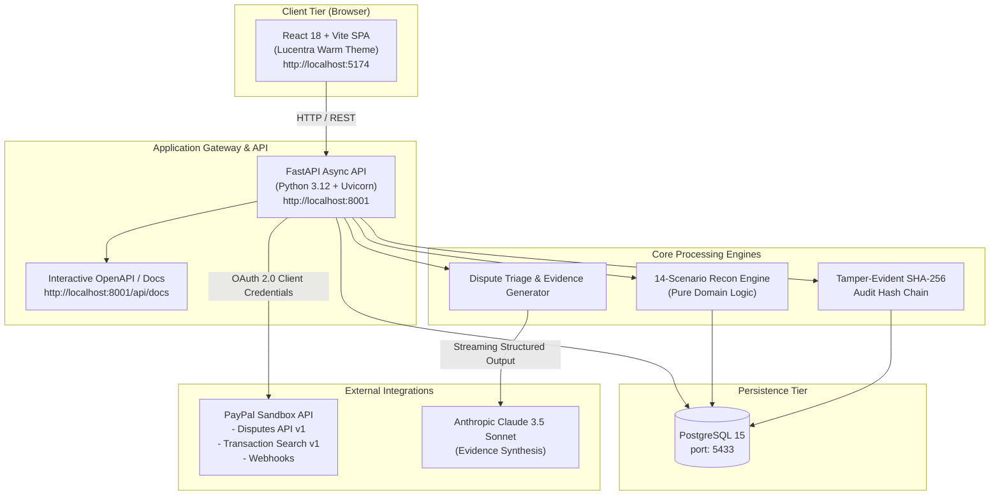

# Lucentra 🛡️⚖️
### AI-Powered Dispute Resolution, 14-Scenario Reconciliation & Revenue Protection for PayPal Merchants

[](https://devpost.com)
[](https://fastapi.tiangolo.com)
[](https://react.dev)
[](https://www.typescriptlang.org)
[](https://www.postgresql.org)
[](https://www.docker.com)
[](LICENSE)

---

## 📌 Executive Summary

**Lucentra** is an enterprise-grade financial intelligence and revenue-protection platform built specifically for high-volume merchants utilizing the **PayPal Commerce Platform**. 

Payment disputes, chargebacks, settlement reconciliation delays, and fee discrepancies cost digital merchants up to **3-5% of their gross revenue annually**. Merchants lose winnable disputes simply due to missed response deadlines, incomplete evidence formatting, or ledger mismatch blindness.

Lucentra solves this end-to-end:
1. **Automated Dispute Triage & AI Evidence Generation**: Automatically categorizes incoming PayPal disputes, scores winnability likelihood, and leverages Claude 3.5 Sonnet to synthesize exhaustive, bank-ready rebuttal evidence packs in seconds.
2. **Pure Domain 14-Scenario Reconciliation**: Ingests PayPal Transaction Search records and reconciles them against store orders across 14 deterministic match/mismatch scenarios (including fee tolerances, multi-currency FX shifts, ghost authorizations, and delayed captures).
3. **Cryptographically Chained Audit Trail**: Every ingestion event, reconciliation finding, AI generation, and dispute response is anchored to an immutable, sequential SHA-256 hash chain with canonical JSON formatting.
4. **"Ask Lucentra" Financial Copilot**: Plain English contextual analytics enabling finance teams to question their PayPal settlement history, dispute exposure, and upcoming deadlines.

---

## 🏛️ High-Level Architecture



---

## ⚡ Core Capabilities

### 1. 14-Scenario Deterministic Reconciliation Engine
Located in `backend/app/domain/recon/engine.py`. Handles real-world edge cases with mathematical precision:
- **Rule 1 — Absolute Minor Currency Units**: All financial computations are conducted in integer minor units (cents) to eliminate IEEE 754 floating-point inaccuracies.
- **Rule 2 — Multi-Currency Matching**: Handles base amounts, converted amounts, and dynamic FX fee variance.
- **Rule 3 — Fee Discrepancy Tolerance**: Flags PayPal fixed ($0.30 or $0.49) + variable % fee anomalies that violate merchant rate contracts.
- **Rule 4 — Anomaly Detection**:
  - `EXACT_MATCH`: 1:1 match across IDs, amounts, and fees.
  - `FEE_MISMATCH`: Transaction amounts match, but assessed processing fee deviates.
  - `TIMING_DIFFERENCE`: Internal capture timestamp and PayPal settlement timestamp cross midnight UTC.
  - `PARTIAL_REFUND`: Multiple partial refunds linked back to a single parent capture.
  - `CHARGEBACK_WITHOUT_ORDER`: PayPal dispute received for a transaction with no corresponding internal order.
  - `DUPLICATE_CAPTURE`: Accidental double capture on identical authorization IDs.
  - `UNRESOLVED_AUTH`: Abandoned authorization hold that never converted to capture.

### 2. Dispute Auto-Triage & Evidence Synthesis
- Ingests disputes from PayPal Disputes API (`GET /v1/customer/disputes`).
- Enforces strict SLA deadline timers (`response_due_date`) with proactive alert indicators.
- Auto-extracts tracking numbers, delivery carrier receipts, IP address logs, and digital signature logs.
- Constructs bank-ready dispute rebuttal narratives tailored to specific PayPal reason codes:
  - `MERCHANDISE_OR_SERVICE_NOT_RECEIVED`
  - `UNAUTHORISED`
  - `MERCHANDISE_OR_SERVICE_NOT_AS_DESCRIBED`
  - `CREDIT_NOT_PROCESSED`

### 3. Cryptographic Tamper-Evident Audit Chain
- Implemented in `backend/app/domain/audit/hash_chain.py`.
- Enforces **RFC 8785 canonical JSON formatting** (sorted keys, compact delimiters) for deterministic hashing.
- Calculates `current_hash = SHA256(prev_hash + sequence + timestamp + action + actor + canonical_data)`.
- Exposes a one-click verification endpoint (`GET /api/v1/audit/verify`) to mathematically guarantee zero database record tampering.

### 4. Enterprise-Grade UI Design
- Crafted with **Lucentra Warm Design System** using Tailwind CSS tokens:
  - Deep Navy Slate background (`#0B1120`, `#0F172A`)
  - Warm Amber accents (`#F59E0B`)
  - Emerald Green verified states (`#10B981`)
  - Crimson dispute danger states (`#EF4444`)
- 10 distinct, responsive production views:
  1. `Landing.tsx` — Platform overview & feature highlights
  2. `Dashboard.tsx` — Revenue protection metrics, exposure chart, triage velocity
  3. `Disputes.tsx` — Case queue, filter tabs, winnability scores
  4. `Evidence.tsx` — AI evidence package builder and live preview
  5. `Reconciliation.tsx` — 14-scenario comparison ledger
  6. `Transactions.tsx` — PayPal ledger history & raw JSON inspector
  7. `Deadlines.tsx` — Calendar & countdown timers for response SLAs
  8. `Audit.tsx` — Visual blockchain-style hash chain inspector
  9. `AskLucentra.tsx` — Interactive financial analytics copilot
  10. `Sandbox.tsx` — PayPal sandbox simulator & webhook triggers

---

## 📂 Project Structure

```
Lucentra/
├── backend/                       # FastAPI application
│   ├── alembic/                   # Database migrations
│   │   ├── versions/              # Migration revision scripts
│   │   └── env.py                 # Async migration runner
│   ├── app/
│   │   ├── api/                   # REST API routes (v1)
│   │   │   ├── audit.py           # Audit chain verification
│   │   │   ├── disputes.py        # Dispute triage & evidence
│   │   │   ├── health.py          # Service health check
│   │   │   ├── reconciliation.py  # Recon execution & discrepancies
│   │   │   └── transactions.py    # PayPal transaction endpoints
│   │   ├── config.py              # Pydantic v2 settings & env parsing
│   │   ├── db/                    # SQLAlchemy async engine & ORM models
│   │   ├── domain/                # Pure business logic (zero framework dependencies)
│   │   │   ├── audit/hash_chain.py
│   │   │   ├── money.py           # Integer minor unit money representation
│   │   │   └── recon/engine.py    # 14-scenario reconciliation engine
│   │   ├── services/              # External services (PayPal, AI, Ingestion)
│   │   │   ├── ai_service.py      # Anthropic Claude evidence synthesis
│   │   │   ├── paypal_client.py   # Resilient PayPal Sandbox HTTP client
│   │   │   └── transaction_service.py
│   │   └── main.py                # FastAPI factory & middleware setup
│   ├── tests/                     # 26+ pytest unit & integration tests
│   ├── Dockerfile                 # Production backend container definition
│   └── pyproject.toml             # Python 3.12 dependencies via hatchling
├── frontend/                      # React 18 + TypeScript + Vite
│   ├── src/
│   │   ├── components/            # UI components, layout, and navbars
│   │   ├── pages/                 # 10 core application pages
│   │   ├── services/              # Axios/Fetch API client hooks
│   │   ├── App.tsx                # Client-side routing
│   │   └── main.tsx               # Root entry point
│   ├── Dockerfile.dev             # Vite container definition
│   └── vite.config.ts             # Vite server config & reverse proxy
├── docker-compose.yml             # Orchestration for Postgres, Backend, Frontend
├── Makefile                       # Developer shortcuts (test, lint, migrate)
├── SETUP.md                       # Comprehensive teammate onboarding guide
└── CHECKLIST.md                   # Feature compliance & hackathon milestone tracking
```

---

## 🚀 Quick Start (Under 2 Minutes)

### With Docker Compose (Recommended)

```bash
# 1. Clone repository
git clone https://github.com/sam28iksha/Lucentra.git
cd Lucentra

# 2. Setup environment files
cp backend/.env.example backend/.env
cp frontend/.env.example frontend/.env

# 3. Spin up all containers
docker compose up -d --build

# 4. Apply database migrations
docker compose exec backend alembic upgrade head
```

### Access URLs

| Application | URL | Description |
| :--- | :--- | :--- |
| **Frontend Web App** | [http://localhost:5174](http://localhost:5174) | React dashboard & portal |
| **Backend API** | [http://localhost:8001](http://localhost:8001) | FastAPI endpoints |
| **Interactive API Docs** | [http://localhost:8001/api/docs](http://localhost:8001/api/docs) | Swagger UI |
| **PostgreSQL Database** | `localhost:5433` | Database: `lucentra`, User: `lucentra` |

> 📖 **Full Instructions & Bare-Metal Setup**: See [SETUP.md](file:///Users/samikshakhandelwal10a27gmail.com/Lucentra/SETUP.md) for detailed configuration, PayPal Sandbox testing, and local virtual environment setups.

---

## 🧪 Testing & Code Quality

Lucentra maintains strict production-grade software engineering standards:

```bash
# Run backend unit tests (26 passing tests)
docker compose exec backend pytest -v

# Run strict type checking (0 errors across all files)
docker compose exec backend mypy app/

# Run linter
docker compose exec backend ruff check .

# Frontend type check
cd frontend && npm run build
```

---

## 👥 PayPal AI Hackathon Team
- **Project**: Lucentra
- **Repository**: [https://github.com/sam28iksha/Lucentra](https://github.com/sam28iksha/Lucentra)
- **Target Deadline**: November 12, 2026 (12:00 PM Pacific / Nov 13, 1:30 AM IST)
